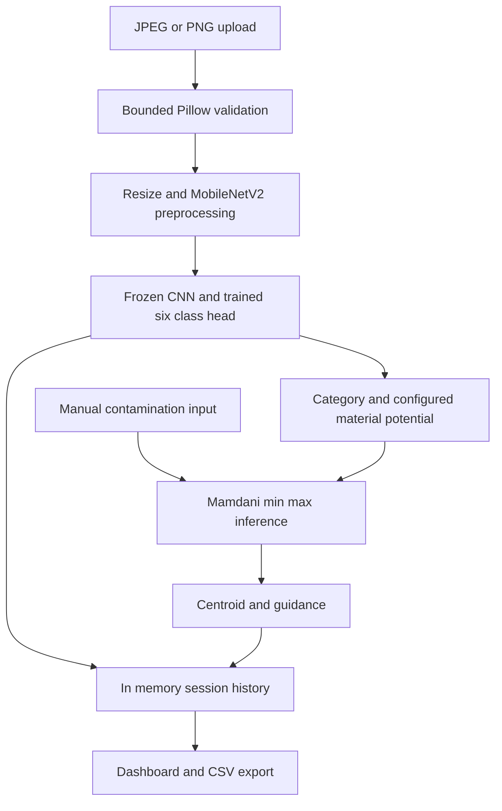
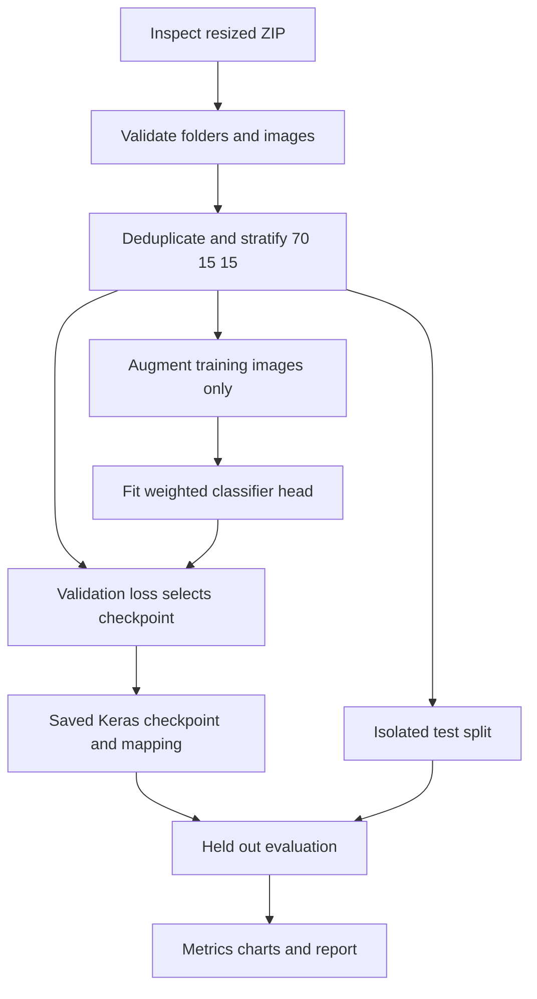

# SmartWaste AI system architecture

The local Streamlit process combines two independent computational paths: CNN material recognition and NumPy fuzzy inference. The engine has no UI or TensorFlow dependency. No separate API server, account system or database is used.

## Components and contracts

| Component | Responsibility | Main contract |
|---|---|---|
| `config.py` | Paths, labels, seed, material assumptions and fuzzy definitions | Labels retain original lowercase names |
| `preprocessing.py` | JPEG/PNG decode, limits, EXIF, RGB conversion, resize | Raw resize returns float32 [0,255]; model preprocessing returns [-1,1] |
| `dataset.py` | Inventory, decoded-image hashes, duplicate removal, stratification | No identical hash spans two splits |
| `model.py` | MobileNetV2 construction, safe load, mapped inference | Six finite softmax outputs; top three sorted scores |
| `fuzzy_engine.py` | Memberships, nine min rules, clipping, max aggregate, centroid | Inputs [0,100]; inspectable `FuzzyResult` |
| `evaluation.py` | Macro/class metrics, plots and hashes | Held-out predictions recorded with model and split hashes |
| `recommendations.py` | Qualified segregation advice | Uses predicted material and fuzzy linguistic status |
| `app.py` | Five sections, real session state, controls and rendering | No persistent user photos and no mock predictions |

## Training and artifact flow

The test set is touched only after fitting/checkpoint selection. `splits.csv` preserves relative image paths, decoded hashes, category indices, dimensions and assignments. Exact duplicate images are excluded before splitting. Near duplicates remain a stated limitation. `training_config.json` records software versions, seed, class weights and split sizes. `metrics.json` stores the checkpoint and split SHA-256 digests. Re-evaluation verifies the dataset against the saved hashes.

## Application state and privacy

The uploaded image is decoded in memory and is not written by application code. Only category, scores, numeric fuzzy inputs, suitability, a session activity ID and UTC timestamp enter history. A contamination slider updates the existing record rather than counting as another CNN prediction. Upload changes invalidate stale predictions. Clearing history removes the active result. Streamlit sessions are ephemeral and isolated; CSV export is an explicit user action.

## Errors and assumptions

Missing model, incompatible mapping, invalid softmax output and malformed images produce clear errors. ZIP validation completes before extraction, and dataset installation follows successful image validation. The FIS rejects nonfinite/out-of-range inputs and zero-area outputs. The exact prescribed FIS has local monotonicity violations, recorded in `FUZZY_VALIDATION.md`; no monotonicity correction is applied silently.
