# SmartWaste AI

**DIT UNIVERSITY**

**CSN441 — Fuzzy Logic and Neural Network**  
**Academic session: ODD 2026–27**  
**Final Year Mini Project**

**Project 4 — Waste Classification Using Images**

## CNN-Based Waste Classification with Mamdani Fuzzy Logic Decision Support for Intelligent Waste Segregation

### Student 1

Name: [STUDENT 1 NAME]  
ERP ID: [STUDENT 1 ERP ID]

### Student 2

Name: [TO BE FILLED IN LATER]  
ERP ID: [TO BE FILLED IN LATER]

Faculty / Supervisor: [FACULTY OR SUPERVISOR NAME]  
Programme / Department: [PROGRAMME AND DEPARTMENT]  
November 2026

---

# Student details

| Group member | Name | ERP ID |
|---|---|---|
| Student 1 | [STUDENT 1 NAME] | [STUDENT 1 ERP ID] |
| Student 2 | [TO BE FILLED IN LATER] | [TO BE FILLED IN LATER] |

# Declaration

We declare that this report describes our SmartWaste AI mini project for CSN441 Fuzzy Logic and Neural Network, ODD 2026–27. The implementation, experimental results and limitations are presented to the best of our knowledge. The dataset, pretrained architecture, software libraries and research used in the work are acknowledged in the references and attribution notes.

The CNN uses pretrained ImageNet features and a trained six-class classifier head. We do not claim authorship of TrashNet or MobileNetV2. The fuzzy potentials are illustrative design assumptions, and suitability is a decision-support score rather than a measured recycling rate.

Student 1 signature: ____________________ Date: ____________________

Student 2 signature: ____________________ Date: ____________________

# Acknowledgement

We thank our course faculty for the opportunity to apply neural networks and fuzzy logic in a complete project. We acknowledge Gary Thung and Mindy Yang for TrashNet, the MobileNetV2 authors, and the maintainers of TensorFlow, Keras, NumPy, Streamlit and the supporting open-source libraries. Their datasets, publications and software provide the foundation for this implementation.

Faculty / Supervisor: [FACULTY OR SUPERVISOR NAME]

# Abstract

SmartWaste AI combines image classification with an inspectable rule-based assessment of recycling suitability. It addresses two different tasks: recognizing a waste material from a photograph and calculating a decision-support score under explicit assumptions. An ImageNet-pretrained MobileNetV2 provides convolutional features for six original TrashNet categories. A newly trained softmax head assigns material scores. The predicted category selects a configurable material potential, while the user independently enters contamination. A genuine Mamdani Fuzzy Inference System applies nine rules using minimum conjunction, clipped implication, maximum aggregation and centroid defuzzification.

The local Streamlit application exposes classification, the fuzzy calculation, recorded evaluation and session activity. The training pipeline validates images, removes exact decoded duplicates, records a seeded stratified split and evaluates the best validation checkpoint on a separate test set. All displayed experimental metrics must come from those artifacts. Tests additionally reveal that the exact prescribed fuzzy membership shapes do not support global monotonicity guarantees. This limitation is retained explicitly, rather than concealed through score adjustment. The project is an academic prototype; its assumptions and outputs do not establish actual recycling rates or collection eligibility.

The original archive contains 2,527 images; 2,521 unique, unambiguous images remain after conflicting-label duplicate groups are excluded. The seeded split contains 1,764 training, 378 validation and 379 test images. The saved model achieves 81.53% accuracy, 77.73% macro precision, 78.21% macro recall and 77.70% macro F1 on the isolated test partition. Contamination is manually entered and is not inferred by the CNN.

**Keywords:** waste classification, MobileNetV2, transfer learning, TrashNet, Mamdani inference, centroid defuzzification, Streamlit.

# Table of contents

1. [Introduction](#chapter-1-introduction)
2. [Literature review and existing approaches](#chapter-2-literature-review-and-existing-approaches)
3. [Dataset and preprocessing](#chapter-3-dataset-and-preprocessing)
4. [System architecture and methodology](#chapter-4-system-architecture-and-methodology)
5. [Fuzzy logic implementation](#chapter-5-fuzzy-logic-implementation)
6. [Application development](#chapter-6-application-development)
7. [Testing and model evaluation](#chapter-7-testing-and-model-evaluation)
8. [Results and discussion](#chapter-8-results-and-discussion)
9. [Conclusion and future scope](#chapter-9-conclusion-and-future-scope)
10. [Demonstration](#chapter-10-demonstration)
11. [References](#references)
12. [Appendix A — Selected implementation excerpts](#appendix-a-selected-implementation-excerpts)
13. [Appendix B — Execution and reproducibility](#appendix-b-execution-and-reproducibility)

# List of figures

- Figure 4.1 — Actual system architecture.
- Figure 5.1 — Membership functions.
- Figure 5.2 — Computed fuzzy aggregate and centroid.
- Figure 6.1 — Real dashboard.
- Figure 6.2 — Real classification page before upload.
- Figure 6.3 — Real CNN classification and top-three scores.
- Figure 6.4 — Real Fuzzy Logic Laboratory.
- Figure 6.5 — Real Model Evaluation dashboard.
- Figure 6.6 — Real About and Methodology section.
- Figure 7.1 — Actual held-out confusion matrix.
- Figure 7.2 — Actual training and validation accuracy.
- Figure 7.3 — Actual training and validation loss.
- Figure 10.1 — Real fuzzy decision panel.
- Figure 10.2 — Real decision after contamination reaches 100.

# List of tables

- Table 3.1 — Original and validated category counts.
- Table 3.2 — Actual data split.
- Table 4.1 — CNN layer configuration.
- Table 4.2 — Recorded training configuration.
- Table 5.1 — Material potentials.
- Table 5.2 — Exact membership definitions.
- Table 5.3 — All nine fuzzy rules.
- Table 5.4 — Numerical inference examples.
- Table 7.1 — Aggregate test metrics.
- Table 7.2 — Per-class metrics.
- Table 7.3 — Numeric confusion matrix.
- Table 8.1 — Monotonicity counterexamples.
- Table 10.1 — Demonstration steps.
- Table B.1 — Required assignment stages and report locations.

# Abbreviations

| Abbreviation | Meaning |
|---|---|
| AI | Artificial intelligence |
| CNN | Convolutional neural network |
| FIS | Fuzzy inference system |
| GAP | Global average pooling |
| RGB | Red, green and blue |
| CSV | Comma-separated values |
| GUI | Graphical user interface |
| SHA-256 | 256-bit Secure Hash Algorithm |
| ERP ID | Institutional student identifier |

# Chapter 1 Introduction

## 1.1 Background

Waste segregation involves identifying materials and deciding whether an item is suitable for a particular collection stream. A photograph may help identify a material, but it does not by itself establish the item's contamination, local acceptance or processing feasibility. Treating image recognition and recycling advice as the same prediction would obscure these differences.

This project therefore separates recognition from decision support. A convolutional model identifies one of six material categories. A fuzzy system then combines a category-level assumption with a contamination assessment supplied by the user. This separation makes the inputs and reasoning visible, supports controlled classroom experiments and permits changes to fuzzy assumptions without retraining the CNN.

## 1.2 Problem statement

Manual segregation depends on material knowledge, the condition of the object and local collection practices. Many academic image classifiers report only a category and a maximum score. Such an interface leaves unanswered how an identified category relates to a subsequent recycling recommendation. It can also encourage users to interpret model confidence as evidence of suitability.

The engineering problem is to implement a reproducible visual classifier and a mathematically explicit decision layer in one usable local application. The recognition output must remain distinguishable from the fuzzy assessment. Dataset imbalance, split leakage, malformed input and missing artifacts must be handled directly. Experimental claims must remain tied to an actual held-out evaluation.

## 1.3 Objectives

The project has five practical objectives: identify the six original TrashNet categories from valid uploaded images; train and save a genuine MobileNetV2 transfer-learning model; implement all stages of Mamdani inference separately from the interface; visualize rules and membership calculations interactively; and provide reproducible evaluation, tests and academic documentation.

The intended demonstration includes changing contamination while retaining the same CNN prediction, inspecting the resulting fuzzy trace and explaining the distinction between a model prediction score and a decision-support score. A complete result includes installation commands, provenance artifacts and known limitations, not only interface screenshots.

## 1.4 Scope and intended application

The system recognizes cardboard, glass, metal, paper, plastic and trash. It accepts JPEG and PNG files and runs in a local browser through a single Streamlit process. Session history and CSV export support demonstration without a database. A laboratory allows the two fuzzy inputs to be varied independently of the classifier.

The project does not detect individual objects in a mixed-waste scene, identify hazardous compounds, estimate contamination automatically or determine municipal collection acceptance. It does not contain authentication, cloud infrastructure or an external prediction API. Organic waste is not introduced as an unsupported seventh class.

# Chapter 2 Literature review and existing approaches

TrashNet provides a small labelled dataset collected for material classification by Gary Thung and Mindy Yang [1]. Its simple acquisition setup makes it useful for a controlled prototype but limits the evidence it can provide about diverse real-world scenes. Its original labels are retained to avoid mismatches between training and inference.

MobileNetV2 uses inverted residuals and linear bottlenecks to construct an efficient convolutional architecture [2]. Rather than reproducing the original six-class model from the dataset repository, this project uses the TensorFlow/Keras ImageNet implementation [3] and transfer learning [4]. This choice reduces the amount of task-specific training required, but does not guarantee a particular accuracy on TrashNet.

Zadeh's fuzzy sets describe gradual membership [5]. Mamdani and Assilian demonstrate linguistic rule-based inference [6]. These ideas allow explicit statements such as High potential with Low contamination implying High suitability. They do not establish the numerical material potentials in this project; those values remain supplied design assumptions. A rule base that is ordered linguistically also does not, by itself, prove monotonicity of its defuzzified surface.

## 2.1 Relevance of the selected approach

Manual segregation relies on human judgement about both material and condition. A CNN learns visual material features but does not establish recycling acceptance. MobileNetV2 transfer learning reduces task-specific training by reusing pretrained features. Mamdani reasoning adds visible linguistic rules over declared inputs, with assumptions that require independent validation.

The contribution is their integration with validated data, a manual contamination input and saved evaluation evidence. No controlled benchmark against other CNN architectures was performed, so superiority over alternatives is not claimed.

# Chapter 3 Dataset and preprocessing

## 3.1 Dataset collection and attribution

TrashNet was created by Gary Thung and Mindy Yang [1]. The resized archive used here contains 2,527 original images and occupies 42,834,870 bytes, or approximately 40.85 MiB. Most source images show individual objects against simple backgrounds. The implemented categories retain the original labels: cardboard, glass, metal, paper, plastic and trash. Trash is not renamed organic waste.

**Table 3.1 — Original and validated category counts**

| Category | Original | Validated | Excluded |
| --- | --- | --- | --- |
| cardboard | 403 | 403 | 0 |
| glass | 501 | 498 | 3 |
| metal | 410 | 409 | 1 |
| paper | 594 | 594 | 0 |
| plastic | 482 | 480 | 2 |
| trash | 137 | 137 | 0 |
| Total | 2527 | 2521 | 6 |

## 3.2 Duplicate handling and data validation

The pipeline decodes each image and fingerprints its RGB bytes plus dimensions. The source archive contains three identical-image pairs with contradictory labels. Every member of each ambiguous pair is excluded before splitting. Choosing one label arbitrarily would invent ground truth.

The excluded pairs are glass/glass115.jpg and metal/metal91.jpg; glass/glass176.jpg and plastic/plastic152.jpg; glass/glass389.jpg and plastic/plastic332.jpg. Full paths, hashes and reasons are recorded in the dataset metadata. This leaves 2,521 unique, unambiguous images.

Before extraction, the downloader checks ZIP paths, symlinks, encryption, duplicate targets and size limits. Installation occurs only after successful image and six-folder validation. Exact decoded duplicate handling reduces leakage risk; near duplicates remain a limitation.

## 3.3 Split and preprocessing

**Table 3.2 — Actual data split**

| Subset | Images | Purpose |
|---|---:|---|
| Training | 1,764 | Fit the classification head |
| Validation | 378 | Select checkpoint and monitor learning |
| Test | 379 | Final held-out evaluation |
| Total | 2,521 | Validated modelling inventory |

Pillow decodes only genuine JPEG and PNG content. The application rejects empty, oversized, unsupported and damaged files. It checks a 10 MB compressed-file limit and a 24-megapixel decoded-image limit, handles decompression-bomb warnings, applies EXIF orientation and composites transparency on white before RGB conversion.

Images are resized consistently to the configured square CNN resolution using bilinear interpolation. The default is 160 by 160 pixels with three channels. Raw float pixels remain in [0,255] until the official MobileNetV2 preprocessing function maps them to [-1,1]. Training and inference use that same function. The aspect ratio is resized rather than preserved through letterboxing; this is a deliberate simple baseline that may distort elongated objects.

A deterministic stratified split allocates approximately 70 percent to training, 15 percent to validation and 15 percent to testing. The relative path, category index, dimensions, decoded hash and split assignment are persisted. Random horizontal flips, small rotations and zooms apply only to training batches. Validation and test batches use deterministic preprocessing.

## 3.4 Augmentation and class weighting

Training augmentation uses RandomFlip(horizontal), RandomRotation(0.08) and RandomZoom(0.10), with reflected borders. Rotation is expressed as a fraction of a full turn, approximately 28.8 degrees in either direction. Validation and test images receive deterministic preprocessing.

Balanced weights are calculated from training labels as N_train / (6 × N_train,class). Trash receives a weight of 3.0625, while paper receives approximately 0.7067. This changes loss contributions without duplicating validation or test images.

# Chapter 4 System architecture and methodology

## 4.1 Proposed system

The proposed system contains a learning path and an application path. The learning path validates and partitions the dataset, fits a classifier head and writes measured evaluation artifacts. The application path loads the saved checkpoint and label mapping, obtains a material prediction and runs the independent fuzzy engine on category potential and manual contamination.

The interface exposes evidence at each stage: uploaded image, top three scores, explicit fuzzy inputs, membership degrees, firing strengths, aggregate and centroid. A model missing from disk disables classification with clear training instructions. The laboratory remains usable because it requires neither TensorFlow execution nor a trained checkpoint.

## 4.2 Architecture

The UI imports model, image-processing, fuzzy, chart and guidance modules. Configuration stores category labels and assumptions centrally. The fuzzy engine accepts two finite numbers in [0,100] and returns a complete result object. The classifier accepts a validated RGB image and returns mapped softmax scores and input dimensions. This division allows the mathematical engine to be tested without Streamlit or TensorFlow.


The main information flow is image validation, consistent preprocessing, CNN category prediction, lookup of material potential, manual contamination, Mamdani inference and qualified guidance. History records numeric results in memory. The training path and application path meet only through saved artifacts, preventing a UI interaction from accidentally retraining the model.

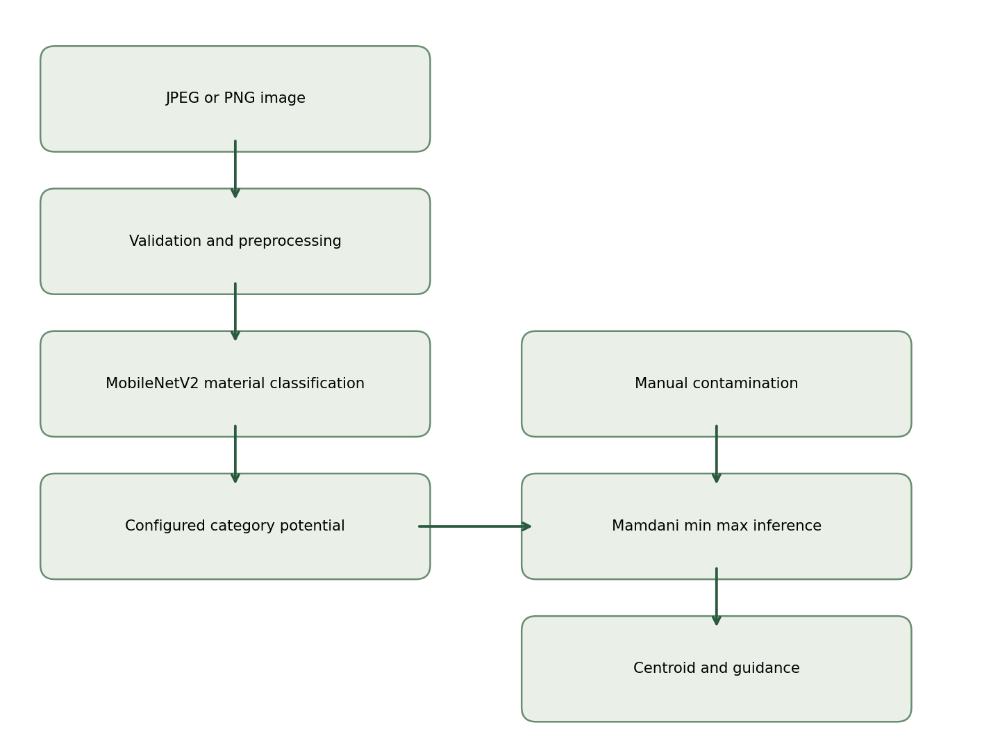

## 4.3 CNN architecture

The convolutional base is MobileNetV2 initialized with ImageNet weights, with its original classification head removed. Its parameters remain frozen in the implemented baseline. A global average pooling layer summarizes the spatial feature maps, a dropout layer with rate 0.3 regularizes the head, and a dense six-unit softmax layer produces category scores.

Integer labels follow a fixed alphabetical mapping: cardboard 0, glass 1, metal 2, paper 3, plastic 4 and trash 5. Sparse categorical cross entropy matches this encoding. Adam starts at learning rate 0.001. Balanced inverse-frequency class weights are calculated from training labels only. There is no duplication of validation or test images to balance class counts.

Training runs for up to 12 epochs by default, with batch size 32 and seed 42. Early stopping monitors validation loss with patience four. Checkpointing saves only the best validation-loss model; learning-rate reduction uses patience two and factor 0.5. Final-layer fine-tuning is not enabled in the baseline, keeping the CPU cost and experimental design manageable.

**Table 4.1 — CNN layer configuration**

| Layer or stage | Actual configuration |
|---|---|
| Input | 160 × 160 × 3 normalized RGB |
| MobileNetV2 | ImageNet weights, include_top=False, alpha=1.0, frozen |
| Final convolutional map | 5 × 5 × 1,280 |
| Global average pooling | 1,280 features |
| Dropout | Rate 0.3 |
| Dense softmax | Six scores; 7,686 trainable head parameters |

## 4.4 Transfer learning

The pretrained base supplies visual features learned on ImageNet, while the new head learns their relationship to waste categories. Freezing the base reduces trainable parameters and avoids destabilizing pretrained batch-normalization statistics on a small dataset. The base is explicitly called with training disabled; dropout in the added head remains active during fitting.

Transfer learning can improve data efficiency, but the source and target domains differ. Metallic reflections, translucent plastic, white paper and similar backgrounds can still be confused. The project therefore evaluates the resulting model rather than treating pretraining as evidence of a specific accuracy. Any future fine-tuning must be chosen with validation data, followed by a fresh clearly identified evaluation protocol.

## 4.5 Training configuration

**Table 4.2 — Recorded training configuration**

| Parameter | Actual setting |
|---|---|
| Input and batch size | 160 × 160 RGB; 32 |
| Random seed and threads | 42; two intra- and inter-op threads |
| Optimizer | Adam |
| Initial learning rate | 0.001 |
| Loss | Sparse categorical cross entropy |
| Epochs completed | 12 |
| Best checkpoint | Epoch 10, selected by validation loss |
| Early stopping | Validation loss, patience 4, restore best weights |
| Learning-rate reduction | Factor 0.5, patience 2, minimum 0.00001 |
| Recorded training runtime | Python 3.11.18, TensorFlow 2.20.0 |

## 4.6 Model inference

The loader verifies the original class ordering, square RGB input and six output units, then loads the actual Keras checkpoint in safe mode. The predicted vector must contain six finite, nonnegative scores summing approximately to one. Sorting it provides the predicted material and top three outputs.

A softmax score ranks image classes and is not a guarantee of correctness. The predicted category selects an assumed material potential. The user supplies contamination independently; the CNN has no contamination output.

# Chapter 5 Fuzzy logic implementation

## 5.1 Why fuzzy logic follows the CNN

The fuzzy stage uses material recyclability potential and contamination level as its two inputs. Both range from 0 to 100. The category selects an illustrative potential, and the user assesses visible contamination manually. The output is recycling suitability on the same normalized scale.

| Category | Assumed material potential |
|---|---:|
| cardboard | 80 |
| glass | 85 |
| metal | 90 |
| paper | 75 |
| plastic | 60 |
| trash | 15 |

These are supplied academic assumptions, not experimentally measured rates. They are stored in a separate configuration file. The fuzzy calculation does not estimate a real-world recovery percentage and does not check whether a local recycler accepts a particular resin, coating or container.

**Table 5.1 — Material potential assumptions**

| Category | Potential on 0 to 100 |
| --- | --- |
| cardboard | 80 |
| glass | 85 |
| metal | 90 |
| paper | 75 |
| plastic | 60 |
| trash | 15 |

Both inputs and the output use the normalized universe [0,100]. Material potential is a category-level assumption, contamination is a manual assessment, and suitability is a rule-system output. Membership degrees describe belonging to linguistic sets; they are not probabilities. None of these quantities measures actual recovered material.

## 5.2 Membership functions and fuzzification

**Table 5.2 — Exact membership definitions**

| Set | Shape | Parameters |
|---|---|---|
| Low | Trapezoid | [0, 0, 25, 50] |
| Medium | Triangle | [25, 50, 75] |
| High | Trapezoid | [50, 75, 100, 100] |

Each input and the output use three linguistic sets: Low, Medium and High. Low is trapezoidal with parameters [0,0,25,50], Medium is triangular with [25,50,75], and High is trapezoidal with [50,75,100,100]. The implementation handles repeated shoulder endpoints explicitly, so Low has membership one at zero and High has membership one at 100 without division by zero.

For an ordinary triangle (a,b,c), membership is max(0, min((x-a)/(b-a), (c-x)/(c-b))). For a trapezoid (a,b,c,d), the rising and falling linear branches bound a plateau of height one. A repeated left or right endpoint denotes a shoulder; membership is zero outside the configured support. For input 37.5 the given shapes return Low 0.5, Medium 0.5 and High 0.


Membership is a degree of belonging to a linguistic set. It must not be interpreted as the probability of an event. The same normalized value can have positive membership in two sets simultaneously.

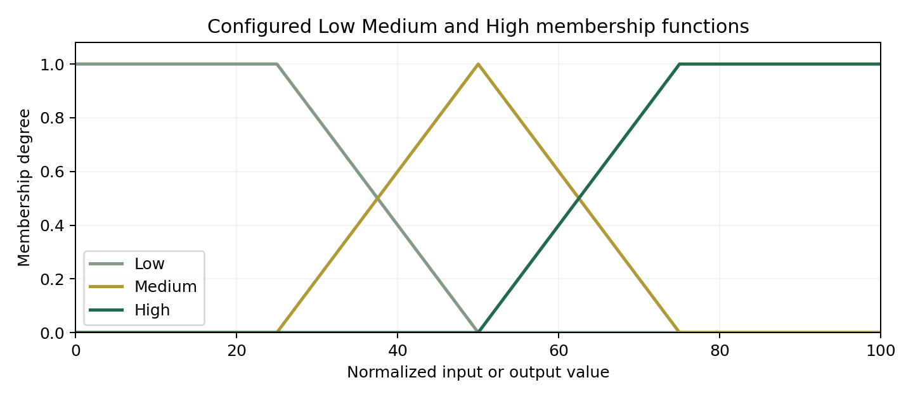

## 5.3 Complete rule base

**Table 5.3 — All nine fuzzy IF-THEN rules**

| Rule | Material potential | Contamination | Suitability |
|---|---|---|---|
| R1 | Low | Low | Low |
| R2 | Low | Medium | Low |
| R3 | Low | High | Low |
| R4 | Medium | Low | Medium |
| R5 | Medium | Medium | Medium |
| R6 | Medium | High | Low |
| R7 | High | Low | High |
| R8 | High | Medium | Medium |
| R9 | High | High | Low |

| Material potential | Low contamination | Medium contamination | High contamination |
|---|---|---|---|
| Low | Low | Low | Low |
| Medium | Medium | Medium | Low |
| High | High | Medium | Low |

The nine explicit rules cover the Cartesian product of the three input sets. For example, R7 states: IF material potential is High AND contamination is Low THEN suitability is High. R8 gives Medium suitability for High potential and Medium contamination. R9 gives Low suitability for High potential and High contamination. All Low-potential cases imply Low suitability.

The rule table is an expert-style design supplied for demonstration. It has not been fitted to observed recycling outcomes. Every rule remains inspectable in the laboratory, including zero-strength rules, so absence of activation is distinguishable from a missing rule.

## 5.4 Minimum conjunction, implication and aggregation

Fuzzification calculates the six antecedent degrees. Each rule firing strength is the minimum of its material degree and contamination degree. The output membership function named by the rule is clipped at that strength. The aggregate at each output sample is the maximum across all nine clipped consequent curves.

For material potential 80 and contamination 20, High potential and Low contamination both have degree one. Only R7 fires, and the aggregate is the full High output trapezoid. For potential 37.5 and contamination 62.5, four rules fire at strength 0.5 and the aggregate combines clipped Low and Medium sets. These cases are checked directly in unit tests.

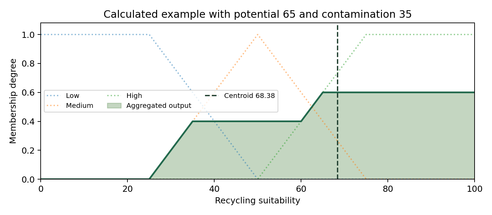


## 5.5 Centroid defuzzification

The crisp score is the first moment of the aggregated output divided by its area: integral(s times membership) divided by integral(membership), from zero to 100. The numerical universe contains 1,001 points. Integration treats adjacent samples as a linear segment and computes its area and first moment analytically; this is more accurate than a simple unweighted sum on coarse samples.

A full Low trapezoid has area 37.5 and centroid 175/9, approximately 19.4444. Its reflected High shape has centroid 725/9, approximately 80.5556. A full symmetric Medium triangle has centroid 50. These independent analytic cases verify the implementation. An aggregate with zero area raises an error rather than producing NaN or an arbitrary default.

The linguistic status is the output set with the highest membership at the centroid. It provides a readable label but adds no new measurement. The crisp value remains available alongside the aggregate chart.

**Table 5.4 — Numerical inference examples**

| Material potential | Contamination | Activated rule | Suitability |
|---:|---:|---|---:|
| 80 | 20 | R7 at 1.0 | 80.555556 |
| 90 | 20 | R7 at 1.0 | 80.555556 |
| 90 | 100 | R9 at 1.0 | 19.444444 |

For the first example, the full High trapezoid has area 37.5 and first moment 3,020.833333, giving 80.555556. The full Low set has area 37.5 and first moment 729.166667, giving 19.444444. The code integrates sampled linear segments analytically; an empty aggregate produces an error.

# Chapter 6 Application development

## 6.1 Components and state

The repository uses separate modules for preprocessing, dataset handling, CNN construction, fuzzy inference, evaluation, recommendations and charts. The model loader checks the original class ordering and input/output dimensions before inference. It rejects nonfinite or invalid softmax outputs. Keras loading uses safe mode and no arbitrary custom objects.

The training command saves the checkpoint, label mapping, configuration, history, splits, class distribution, held-out predictions and evaluation charts. The evaluation file records model and split hashes. A separate evaluation command checks that current dataset hashes still match the recorded split. The interface does not present an evaluation whose model hash differs from the current checkpoint.

Classification history counts actual button-triggered model predictions. Changing contamination updates the associated activity entry instead of adding a new CNN classification. Changing the upload invalidates the previous active result. Session rows contain numeric outcomes, a category and a timestamp; no photograph is written by application code.

## 6.2 Interface

The Dashboard presents session totals, material distribution, mean suitability and recent activity. An empty session contains explanatory text, without invented sample metrics. CSV export and clear-history actions operate on that session's recorded data.

Waste Classification provides validation, an image preview, loading state, top three scores and the model input dimensions. A separate fuzzy section labels material potential as an assumption and contamination as a manual assessment. The Fuzzy Logic Laboratory exposes both inputs, all membership functions, degrees, rules, firing strengths, aggregate and centroid. Model Evaluation shows actual held-out metrics and curves; About and Methodology explains the architecture and limitations.

The visual style uses forest green, off-white and muted sage, with restrained cards and consistent typography. Native Streamlit widgets preserve ordinary browser interaction. Screenshots, when generated from a real running application, are included as figures; no synthetic interface image is presented as evidence of execution.

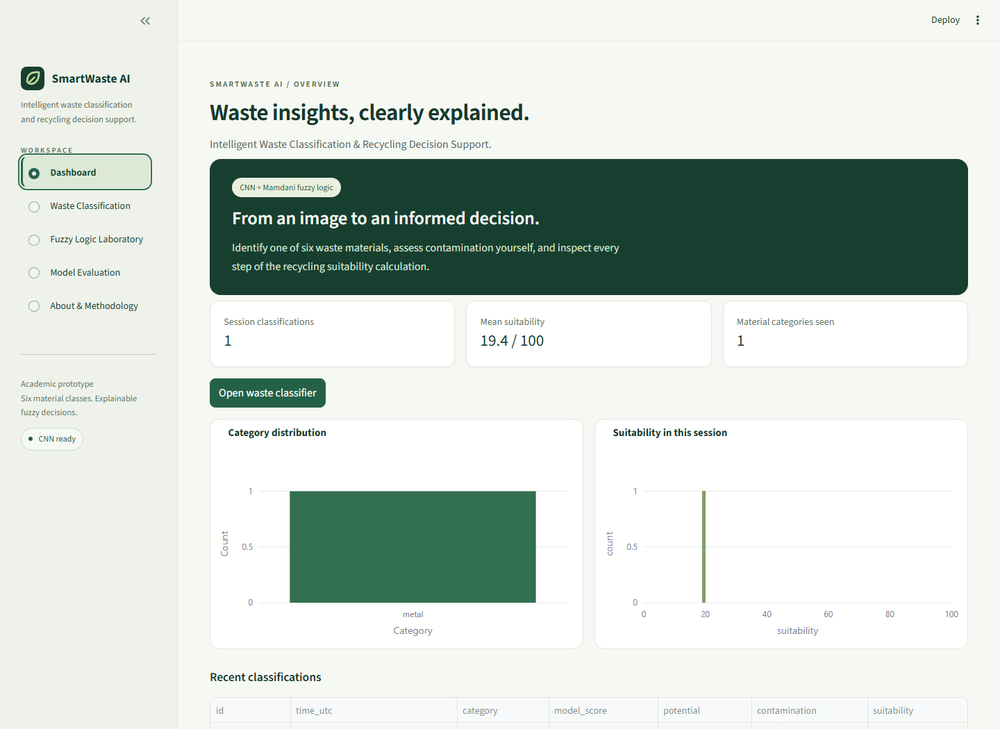

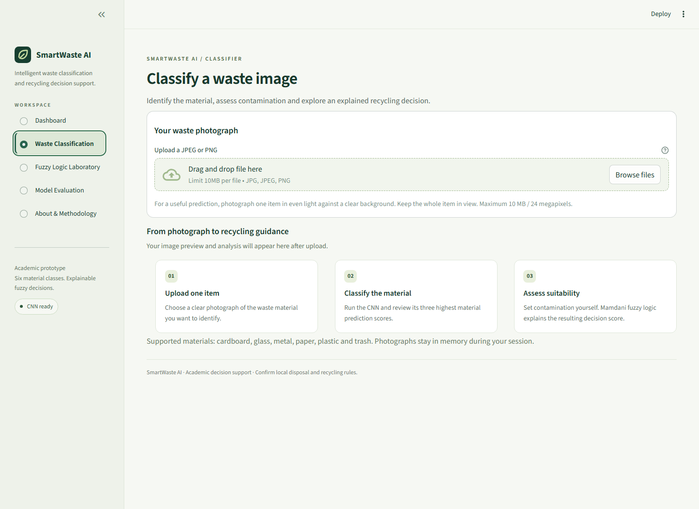

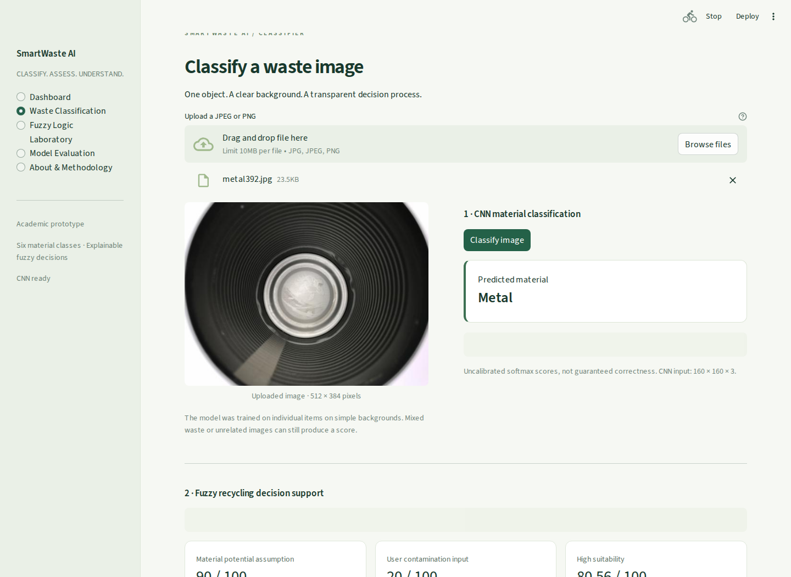

The shown metal392.jpg image is 512 × 384 pixels. The actual application predicts Metal and displays metal 0.989, glass 0.004 and cardboard 0.003. Only the top three of six scores are shown, and the displayed values are rounded.

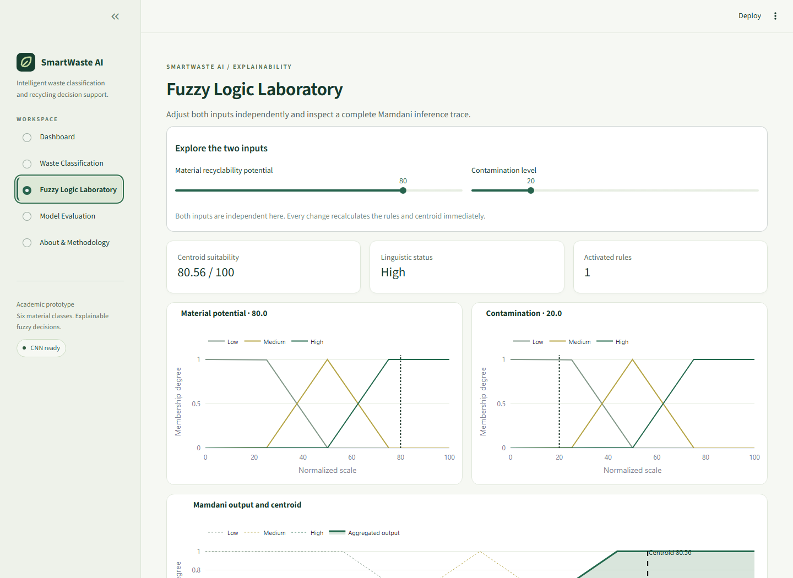

The displayed laboratory inputs are potential 80 and contamination 20. The result is High suitability 80.56 / 100 with one active rule. The existing screenshot shows the input membership plots and the beginning of the aggregate. A dedicated lower-screen screenshot of the complete aggregate and activated-rule table remains to be captured during final export.

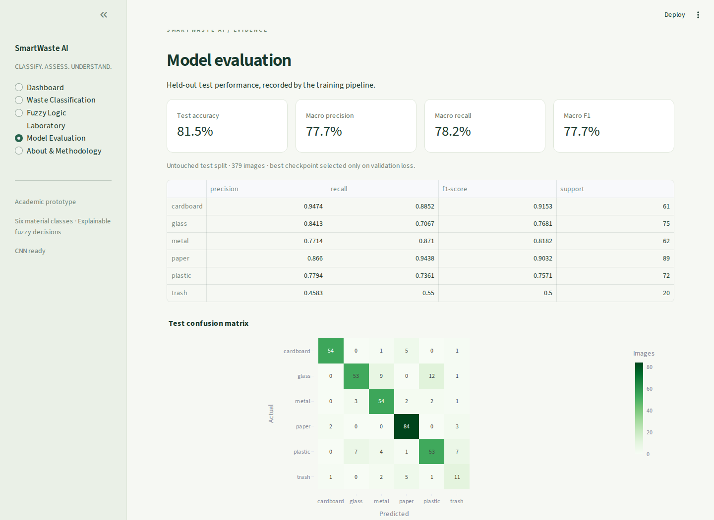

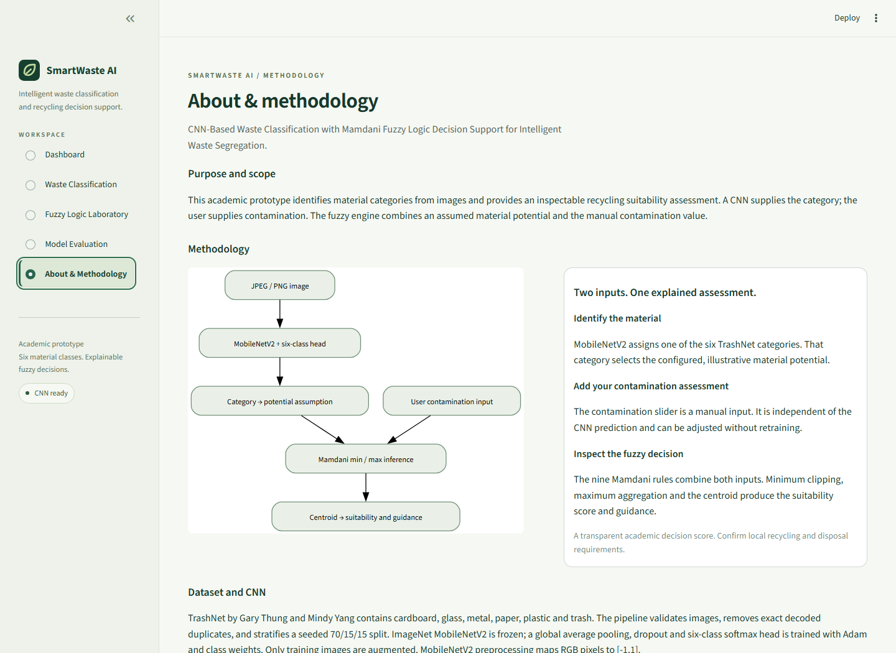

## 6.3 Software and execution requirements

| Resource | Requirement or implementation choice |
|---|---|
| Operating system | Windows with 64-bit Python 3.11; CI also validates Linux CPU execution |
| Deep learning | TensorFlow 2.20 and Keras MobileNetV2 |
| Interface | Streamlit 1.51, Plotly and custom CSS |
| Processing | Pillow, NumPy, Pandas and Scikit-learn |
| Academic artifacts | Matplotlib, python-docx and Markdown |
| Testing | Pytest and unittest-compatible test cases |
| Compute | CPU supported; a GPU is not required |
| Memory | 8 GB RAM recommended for comfortable training; actual needs depend on resolution and batch size |
| Connectivity | Initial package, resized dataset and ImageNet weight downloads |

Dependencies are installed in a project virtual environment. The setup script does not replace or uninstall a system Python. No credentials are required for local use. Exact package pins appear in `requirements.txt`; the training configuration records the actual Python and TensorFlow versions used for a completed run.

# Chapter 7 Testing and model evaluation

## 7.1 Experimental setup

The reproducibility defaults are seed 42, approximately 70/15/15 stratification, 160-pixel inputs, batch size 32, ImageNet MobileNetV2 with frozen base, dropout 0.3 and Adam at 0.001. Class weights are derived from the training subset. Augmentation occurs only while fitting. The test partition is not used to select the checkpoint or alter training settings.

The setup script creates an isolated environment on Windows. Repository CI can repeat package installation, tests and a real Streamlit health check on a Linux CPU worker. When no checkpoint exists, the initial main-branch workflow downloads the resized dataset, performs actual training and evaluation, runs tests again and saves the resulting artifacts through a normal fast-forward commit. Any environment restriction must be recorded as a restriction, not replaced with simulated findings.

## 7.2 Software and integration testing

Tests cover membership values and shoulder endpoints, invalid fuzzy inputs, exact polygon centroids, zero-area errors, rule counts, activation strengths, aggregate construction, sampled output range and known monotonicity counterexamples. Image tests include supported formats, transparency, damaged content, unsupported formats, size limits, output shape and pixel range. Dataset tests validate extraction safety, folder requirements, duplicate handling and disjoint seeded splits.

TensorFlow integration tests construct and serialize the real architecture without downloading weights, verify normalization and validate a supplied trained artifact against recorded hashes. Streamlit AppTest opens every section, changes laboratory inputs, checks navigation and exercises actual session clearing. A real server health endpoint is checked separately in CI. Dependency-specific tests are explicitly skipped when their dependencies are unavailable; skipped tests are not evidence that the corresponding feature has run.

The required command is `python -m pytest -q`. An offline-compatible alternative for installed core dependencies is `python -m unittest discover -s tests -v`. The current validation status, including dependency restrictions, is recorded in `docs/VALIDATION.md`. Two expected failures are known unmet global properties, not concealed passing assertions.

The completed full-environment validation record reports 34 passed tests, 2 xfailed cases and 6 passed subtests, with no model or dependency skips. The xfailed cases expose the two known unmet global monotonicity properties. They are not unexpected software failures and do not establish passing monotonicity guarantees.

The recorded Windows and Linux validation also covers real image upload, contamination changes, session CSV export and Streamlit startup. The five application sections were checked at 1920 × 1080, 1366 × 768 and 1280 × 720.

## 7.3 Held-out aggregate metrics

**Table 7.1 — Actual metrics on 379 held-out images**

| Metric | Measured value |
| --- | --- |
| Accuracy | 81.53% |
| Macro precision | 77.73% |
| Macro recall | 78.21% |
| Macro F1 | 77.70% |

The checkpoint correctly classifies 309 out of 379 images, producing 70 errors. Accuracy is 309/379 = 0.8153034301. Validation loss selects epoch 10; the final epoch is not automatically selected. The test partition is isolated from fitting and checkpoint selection.

Precision is TP/(TP+FP), recall is TP/(TP+FN), and F1 is their harmonic mean. Macro averages give equal weight to each class. Macro F1 is the average of class F1 values, not the harmonic mean of macro precision and macro recall.

## 7.4 Per-class performance

**Table 7.2 — Per-class metrics rounded to four decimals**

| Class | Precision | Recall | F1 | Support |
| --- | --- | --- | --- | --- |
| cardboard | 0.9474 | 0.8852 | 0.9153 | 61 |
| glass | 0.8413 | 0.7067 | 0.7681 | 75 |
| metal | 0.7714 | 0.8710 | 0.8182 | 62 |
| paper | 0.8660 | 0.9438 | 0.9032 | 89 |
| plastic | 0.7794 | 0.7361 | 0.7571 | 72 |
| trash | 0.4583 | 0.5500 | 0.5000 | 20 |

Cardboard has the strongest class F1 at 0.9153, followed by paper at 0.9032. Trash has F1 0.5000 on only 20 test images. Macro metrics therefore reveal weaker minority-class recognition that overall accuracy can obscure.

## 7.5 Confusion matrix

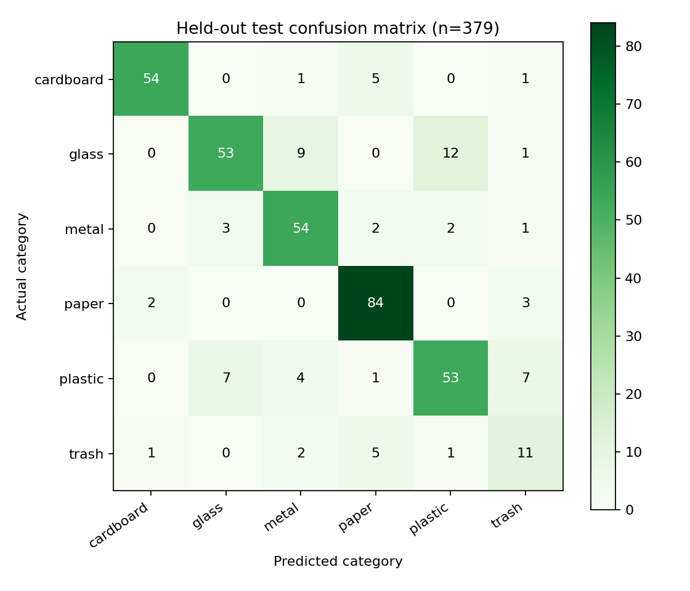

**Table 7.3 — Numeric matrix with actual rows and predicted columns**

| Actual / predicted | cardboard | glass | metal | paper | plastic | trash |
| --- | --- | --- | --- | --- | --- | --- |
| cardboard | 54 | 0 | 1 | 5 | 0 | 1 |
| glass | 0 | 53 | 9 | 0 | 12 | 1 |
| metal | 0 | 3 | 54 | 2 | 2 | 1 |
| paper | 2 | 0 | 0 | 84 | 0 | 3 |
| plastic | 0 | 7 | 4 | 1 | 53 | 7 |
| trash | 1 | 0 | 2 | 5 | 1 | 11 |

The largest off-diagonal count is 12 glass images predicted as plastic, followed by nine glass images predicted as metal. Seven plastic images are predicted as glass and seven as trash. Similar appearance is a plausible contributor, but the matrix alone cannot establish which visual cue caused an individual error.

## 7.6 Training and validation curves

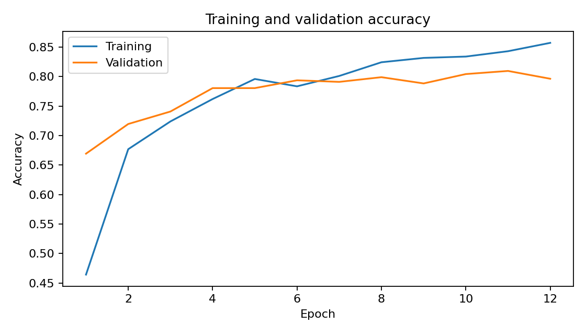

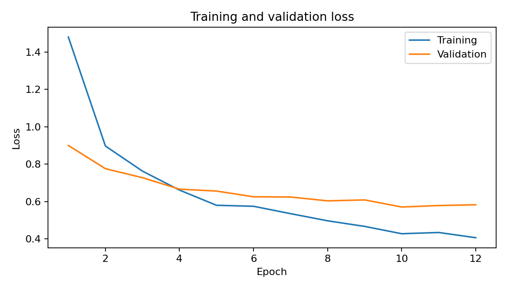

Training accuracy rises from 46.43% to 85.71% over 12 epochs. The lowest validation loss, 0.570204, occurs at epoch 10 with validation accuracy 80.42%. Validation accuracy peaks separately at epoch 11 at 80.95%; selection follows loss. The last epoch has validation loss 0.582194 and accuracy 79.63%.

The later training improvement without sustained validation-loss improvement suggests a developing generalization gap. No ablation study isolates the effects of augmentation, dropout or class weighting.

# Chapter 8 Results and discussion

## 8.1 Classification findings

The actual metal392.jpg application example demonstrates a correct image-level material prediction with an inspectable ranking of class scores. The confusion matrix provides aggregate evidence of 70 misclassifications, including 12 glass-to-plastic errors. Those errors are recorded results; they are not fabricated examples.

Specific misclassified input thumbnails must be paired with the saved split and prediction archive before being added as image examples. The aggregate counts support error analysis without claiming an unverified image-level cause.

## 8.2 Fuzzy inference findings

The fuzzy engine produces genuine computed outputs independently of CNN training availability. Analytic tests establish the expected centroids for fully activated Low, Medium and High consequents. Multi-rule tests verify minimum implication and maximum aggregation. Safety tests exercise invalid images, archive traversal and deterministic split isolation.

A significant mathematical result concerns monotonicity. The exact supplied rule system does not satisfy the additional requirement that every contamination increase must never improve suitability. With potential 15, contamination 25 gives approximately 19.4444, whereas contamination 26 gives approximately 19.6316. Both imply only Low output; the changed clipping height shifts the centroid of its asymmetric shoulder. At contamination 100, raising potential 38 to 39 similarly reduces the centroid from approximately 21.9119 to 21.6899.

These counterexamples persist at finer output resolution and follow the shape geometry. They are not corrected by replacing a calculation with a hardcoded score. The implementation preserves the requested shapes and operators, documents the conflict and retains both global-property checks as explicitly expected failures. Linguistic-peak ordering and normal inference checks still pass. A claim of guaranteed global monotonicity would therefore be unsupported.

**Table 8.1 — Reproducible monotonicity counterexamples**

| Potential | Contamination | Approximate suitability |
|---:|---:|---:|
| 15 | 25 | 19.444444 |
| 15 | 26 | 19.631579 |
| 38 | 100 | 21.9119 |
| 39 | 100 | 21.6899 |

The first pair activates only Low consequents. Changing clipping height shifts the centroid of the asymmetric shoulder. Ordered linguistic consequents therefore do not by themselves prove that the crisp output is globally monotone.

## 8.3 Strengths

The prototype joins a genuine saved checkpoint to an independently testable fuzzy engine. Image checks, fixed class ordering, saved splits, model hashes, per-class metrics and visible rule traces make the experiment auditable. The laboratory supports controlled reasoning without requiring another CNN prediction.

## 8.4 Limitations

The classifier is restricted to six closed-set categories and simple image-level classification. A small imbalanced dataset with simple backgrounds cannot establish general performance in municipal waste scenes. Near duplicates may remain despite exact duplicate removal. Resizing can distort objects. No calibrated confidence or out-of-distribution rejection is implemented, so unrelated images may receive a confident category score.

The fuzzy material potentials and rule table are illustrative. Contamination is subjective and manually entered. The centroid surface has local monotonicity violations under the required definitions. Neither the model score nor fuzzy score measures toxicity, legal eligibility, industrial processing feasibility or the actual mass recovered. The application supplies academic decision support and qualified guidance, while real collection decisions depend on local rules.

# Chapter 9 Conclusion and future scope

## 9.1 Conclusion

SmartWaste AI implements a clear separation between learned material recognition and explicit fuzzy decision support. Its main contribution is an inspectable end-to-end workflow: validated image input, mapped CNN scores, declared fuzzy assumptions, manual contamination, complete rule evaluation and numerical centroid output. Reproducible training and artifact provenance make empirical claims auditable for the completed saved run.

The mathematical validation also identifies a requirement conflict that would otherwise undermine the explanation of the system. Retaining and exposing that limitation makes the prototype more defensible than asserting a property its inference surface does not possess. Demonstration claims should remain tied to executed tests and current evaluation artifacts.

The recorded model demonstrates six-class recognition at 81.53% held-out accuracy, while the application demonstrates manual contamination input, genuine fuzzy inference and session export. These outcomes support the academic objectives within the stated dataset and decision-support scope.

## 9.2 Future scope

Future work should collect diverse locally relevant images, inspect near duplicates, obtain contamination labels and validate material assumptions with recycling practitioners. Model calibration and rejection of unrelated images could improve how uncertainty is communicated. Controlled fine-tuning could be assessed using validation data before a clearly defined final test.

A revised fuzzy specification could explore monotone rule surfaces or alternative output shapes, with full-domain testing before claiming guarantees. Such a revision should preserve inspectability and state whether it changes Mamdani inference, membership functions or adds postprocessing. Local material acceptance rules could be added only with reliable, maintained sources and a clear distinction from image recognition.

# Chapter 10 Demonstration

## 10.1 Procedure

**Table 10.1 — Demonstration steps**

| Step | Action and output |
|---|---|
| 1 | Run setup.bat once, then run.bat. Open the local Streamlit URL, normally localhost:8501. |
| 2 | Open Waste Classification and upload a genuine JPEG/PNG, such as held-out metal392.jpg. |
| 3 | Click Classify image. Inspect the image, Metal prediction and top-three scores. |
| 4 | Confirm the configured metal potential is 90 and contamination is a separate manual input. |
| 5 | At contamination 20, R7 fires at 1.0 and suitability is 80.555556. |
| 6 | Change contamination to 100. The same Metal prediction yields Low suitability 19.444444 through R9. |
| 7 | Inspect the fuzzy memberships, firing strengths, aggregate and centroid. |
| 8 | Open Dashboard, verify one classification and export its session CSV. |

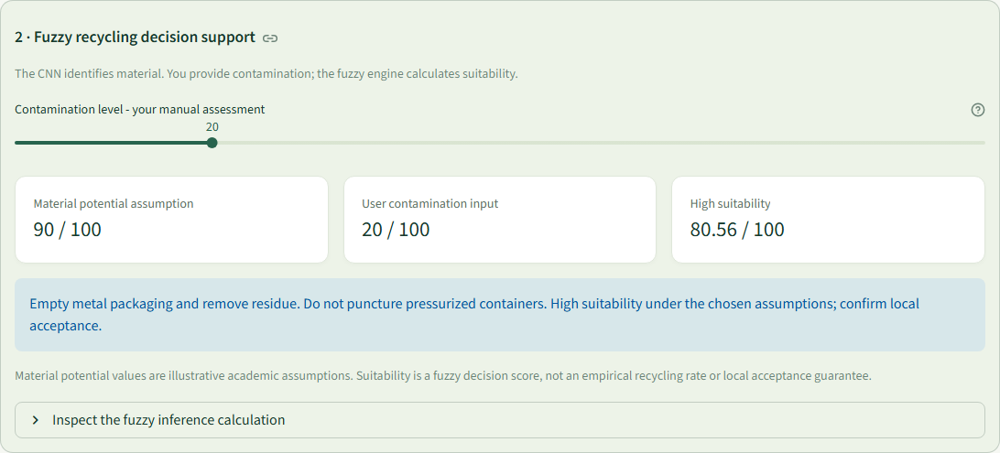

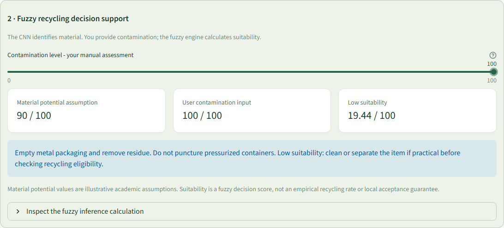

## 10.2 Output interpretation

At potential 90 and contamination 100, High material and High contamination both have membership one. R9 clips the Low output at one, and the centroid is 19.444444, displayed as 19.44 / 100. Material recognition remains unchanged. The guidance recommends cleaning or separating the item where practical and checking local acceptance.

## 10.3 Additional checks

Enter potential 37.5 and contamination 62.5 in the laboratory. Rules R2, R3, R5 and R6 fire at 0.5. Inspect the clipped Low/Medium aggregate and centroid.

An invalid image should produce a validation message without a fabricated prediction. A new upload invalidates the previous active result. Clear History returns the dashboard count to zero. The laboratory is independently usable when no classification is active.

# References

[1] Gary Thung and Mindy Yang. TrashNet dataset and project repository. https://github.com/garythung/trashnet

[2] Mark Sandler, Andrew Howard, Menglong Zhu, Andrey Zhmoginov and Liang-Chieh Chen. MobileNetV2: Inverted Residuals and Linear Bottlenecks. CVPR 2018. https://arxiv.org/abs/1801.04381

[3] TensorFlow. Keras MobileNetV2 API. https://www.tensorflow.org/api_docs/python/tf/keras/applications/MobileNetV2

[4] TensorFlow. Transfer learning and fine-tuning. https://www.tensorflow.org/tutorials/images/transfer_learning

[5] Lotfi A. Zadeh. Fuzzy sets. Information and Control 8(3), 338–353, 1965. https://doi.org/10.1016/S0019-9958(65)90241-X

[6] Ebrahim H. Mamdani and Sedrak Assilian. An experiment in linguistic synthesis with a fuzzy logic controller. International Journal of Man-Machine Studies 7(1), 1–13, 1975. https://doi.org/10.1016/S0020-7373(75)80002-2

[7] Scikit-learn. Classification metrics. https://scikit-learn.org/stable/modules/model_evaluation.html#classification-metrics

[8] Streamlit. AppTest API. https://docs.streamlit.io/develop/api-reference/app-testing/st.testing.v1.apptest

[9] SmartWaste AI. Project source, saved model and experiment artifacts. https://github.com/prxns/SmartWaste-AI

[10] DIT University. CSN441 Fuzzy Logic and Neural Network, ODD 2026–27 Mini Project. Supplied assignment document.

# Appendix A Selected implementation excerpts

## A.1 Image resizing and normalization

Listing A.1 — Shared resizing and inference preprocessing — `smartwaste/preprocessing.py`

```python
def resize_pixels(image, size=IMAGE_SIZE):
    """Return raw RGB float32 pixels in [0,255]; aspect is resized consistently."""
    return np.asarray(image.resize((size, size), Image.Resampling.BILINEAR), dtype=np.float32)


def preprocess_image(image, size=IMAGE_SIZE):
    from tensorflow.keras.applications.mobilenet_v2 import preprocess_input
    return preprocess_input(resize_pixels(image, size).copy())[None, ...]

```

## A.2 CNN construction

Listing A.2 — Actual frozen-base model construction — `smartwaste/model.py`

```python
def build_model(size=IMAGE_SIZE, weights="imagenet", alpha=1.0):
    import tensorflow as tf
    base = tf.keras.applications.MobileNetV2(
        input_shape=(size, size, 3), include_top=False, weights=weights, alpha=alpha)
    base.trainable = False
    inputs = tf.keras.Input((size, size, 3), name="preprocessed_rgb")
    x = base(inputs, training=False)
    x = tf.keras.layers.GlobalAveragePooling2D()(x)
    x = tf.keras.layers.Dropout(0.3)(x)
    outputs = tf.keras.layers.Dense(len(CLASS_NAMES), activation="softmax", name="waste_category")(x)
    model = tf.keras.Model(inputs, outputs, name="smartwaste_mobilenetv2")
    model.compile(optimizer=tf.keras.optimizers.Adam(1e-3),
                  loss="sparse_categorical_crossentropy", metrics=["accuracy"])
    return model
```

## A.3 Model prediction

Listing A.3 — Prediction and mapped output validation — `smartwaste/model.py`

```python
    def predict(self, image):
        scores = np.asarray(self.model(preprocess_image(image, self.size), training=False))[0]
        if scores.shape != (6,) or not np.all(np.isfinite(scores)) or np.any(scores < 0) or not np.isclose(scores.sum(), 1, atol=1e-3):
            raise ValueError("Model did not return six valid softmax scores.")
        order = np.argsort(-scores)
        return {"category": self.class_names[int(order[0])],
                "top_three": [{"category": self.class_names[int(i)], "score": float(scores[i])} for i in order[:3]],
                "scores": dict(zip(self.class_names, map(float, scores))),
                "input_dimensions": [self.size, self.size, 3]}
```

## A.4 Membership functions

Listing A.4 — Actual triangle and trapezoid calculations — `smartwaste/fuzzy_engine.py`

```python
def triangle(x, a, b, c):
    if not a < b < c:
        raise ValueError("Triangle parameters must satisfy a < b < c.")
    x = np.asarray(x, dtype=float)
    return np.maximum(0.0, np.minimum((x-a)/(b-a), (c-x)/(c-b)))


def trapezoid(x, a, b, c, d):
    if not a <= b <= c <= d or a == d:
        raise ValueError("Trapezoid requires a <= b <= c <= d and a < d.")
    x = np.asarray(x, dtype=float)
    left = np.ones_like(x) if a == b else (x-a)/(b-a)
    right = np.ones_like(x) if c == d else (d-x)/(d-c)
    return np.where((x >= a) & (x <= d), np.clip(np.minimum(left, right), 0, 1), 0)
```

## A.5 Fuzzification

Listing A.5 — Input validation and membership calculation — `smartwaste/fuzzy_engine.py`

```python
def fuzzify(value, definitions=None):
    if not np.isfinite(value) or not 0 <= value <= 100:
        raise ValueError("Fuzzy inputs must be finite numbers in [0, 100].")
    return {name: float(membership(value, definition))
            for name, definition in (definitions or MEMBERSHIPS).items()}
```

## A.6 Rule evaluation and aggregation

Listing A.6 — Actual nine-rule min/max engine — `smartwaste/fuzzy_engine.py`

```python
def infer(potential, contamination, definitions=None, rule_table=None, resolution=1001):
    definitions = definitions or MEMBERSHIPS
    names = ("Low", "Medium", "High")
    if set(definitions) != set(names) or resolution < 101:
        raise ValueError("Define Low, Medium and High sets; use at least 101 output samples.")
    p, c = fuzzify(potential, definitions), fuzzify(contamination, definitions)
    universe = np.linspace(0, 100, resolution)
    outputs = {name: membership(universe, definitions[name]) for name in names}
    aggregate = np.zeros_like(universe)
    rules = []
    table = rule_table if rule_table is not None else RULE_TABLE
    if len(table) != 3 or any(len(row) != 3 for row in table):
        raise ValueError("The rule base must contain all nine input combinations.")
    for i, material in enumerate(names):
        for j, contamination_set in enumerate(names):
            consequent = table[i][j]
            strength = min(p[material], c[contamination_set])
            aggregate = np.maximum(aggregate, np.minimum(strength, outputs[consequent]))
            rules.append({"Rule": f"R{i*3+j+1}", "Material": material,
                          "Contamination": contamination_set, "Suitability": consequent,
                          "Firing strength": strength})
    score = centroid(universe, aggregate)
    status = max(fuzzify(score, definitions), key=fuzzify(score, definitions).get)
    return FuzzyResult(float(potential), float(contamination),
                       {"Material": p, "Contamination": c}, rules, universe,
                       outputs, aggregate, score, status)
```

## A.7 Centroid defuzzification

Listing A.7 — Sampled piecewise-linear centroid — `smartwaste/fuzzy_engine.py`

```python
def centroid(x, y):
    """Exact first moment for the polygon defined by the sampled curve."""
    x, y = np.asarray(x, float), np.asarray(y, float)
    if x.ndim != 1 or x.shape != y.shape or len(x) < 2:
        raise ValueError("Centroid requires equally sized one-dimensional arrays.")
    if not np.all(np.isfinite(x)) or not np.all(np.isfinite(y)) or np.any(y < 0):
        raise ValueError("Centroid coordinates must be finite, with nonnegative membership.")
    dx = np.diff(x)
    if np.any(dx <= 0):
        raise ValueError("Output universe must be strictly increasing.")
    area = np.sum(dx * (y[:-1]+y[1:])/2)
    if area <= np.finfo(float).eps:
        raise ValueError("No rule fired: aggregated output has zero area.")
    moment = np.sum(dx * (x[:-1]*(2*y[:-1]+y[1:]) + x[1:]*(y[:-1]+2*y[1:]))/6)
    return float(moment / area)
```

# Appendix B Execution and reproducibility

## B.1 Windows execution

```bat
setup.bat
run.bat

REM Alternative after setup
.venv\Scripts\activate
streamlit run app.py
```

## B.2 Experimental commands

```bat
python -m scripts.download_dataset
python -m scripts.train_model --epochs 12 --threads 2
python -m scripts.evaluate_model
python -m pytest -q
python -m unittest discover -s tests -v
```

The training commands document reproducibility. The completed CNN was not retrained to write this report.

## B.3 Artifact provenance

- Model SHA-256: `753e4de8261cef6ea0dbaa19e018471f5638454a0e5772dba00262b58baeb6da`
- Split SHA-256: `777650b5cd96489f0b7113ef072fd64df2c2bcd13f78c06684f7ea55b1db22f8`
- Dataset archive SHA-256: `0bf472790f8b20e5c950d5b5012a9d38af0d3392efd65f8ce171334fc16b07c2`
- Checkpoint: `models/smartwaste.keras`
- Actual epochs: 12. Best validation-loss epoch: 10.
- Repository: https://github.com/prxns/SmartWaste-AI

## B.4 Assignment coverage

**Table B.1 — Required assignment stages**

| Required stage | Report location |
|---|---|
| Problem definition | Chapter 1 |
| Dataset collection | Chapter 3 |
| Data preprocessing | Chapter 3 |
| Model development | Chapter 4 |
| Model training | Chapters 4 and 7 |
| Model evaluation | Chapter 7 |
| Result analysis | Chapter 8 |
| Conclusion | Chapter 9 |
| Future scope | Chapter 9 |
| Demonstration | Chapter 10 |

Complete both students' names and ERP IDs, faculty and programme fields in the editable Word copy before submission. Apply signatures only after reviewing the declaration. The supplied assignment requests the LMS naming convention Miniproject_FL&NN_ERPID.
