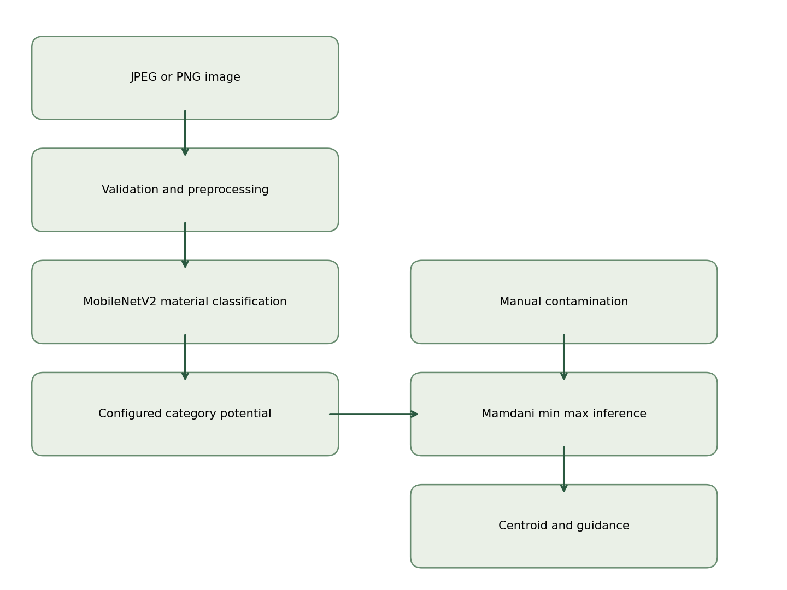
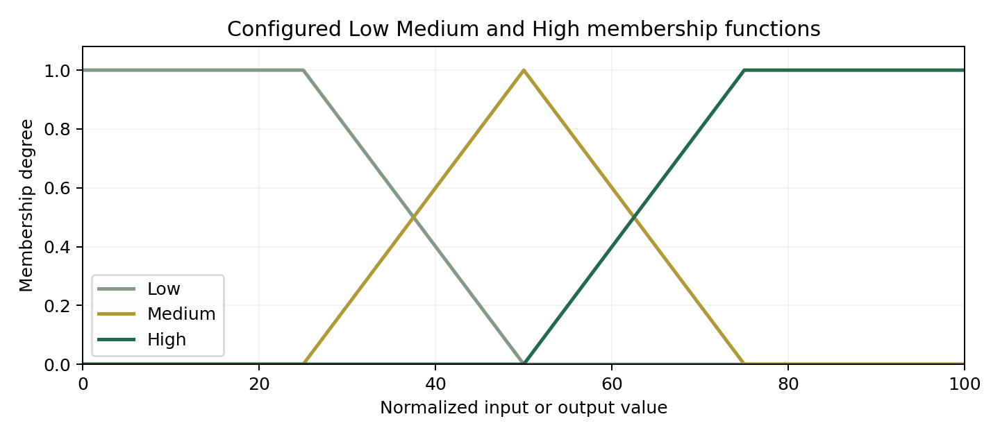
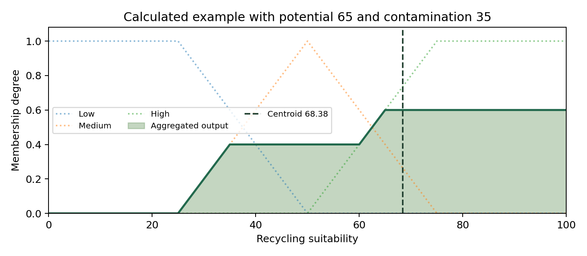
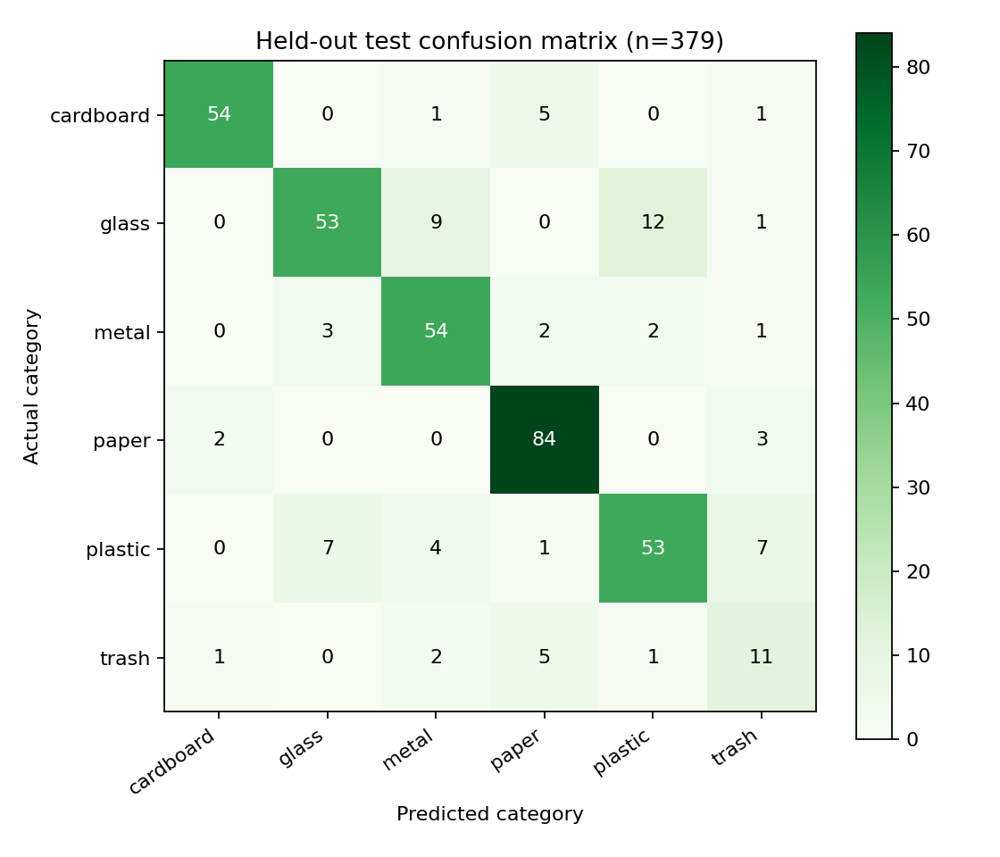
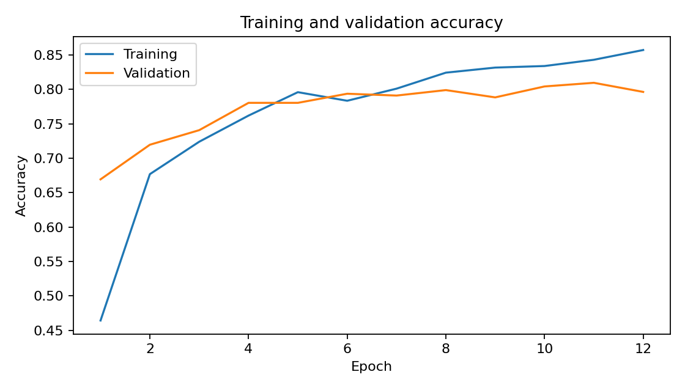
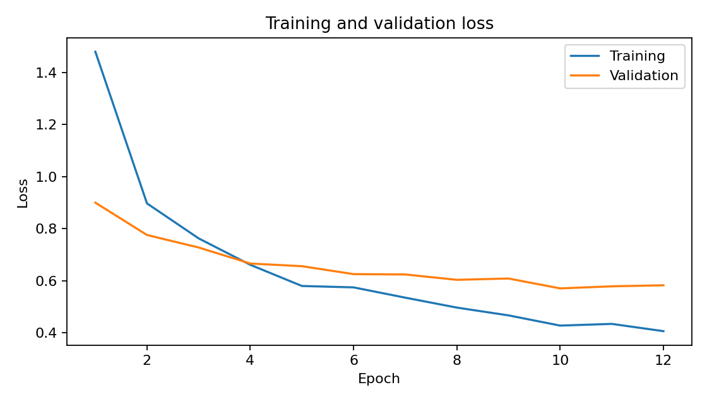

# SmartWaste AI Project Report

CNN-Based Waste Classification with Mamdani Fuzzy Logic Decision Support for Intelligent Waste Segregation

Student: [STUDENT NAME]  
Roll number: [ROLL NUMBER]  
Programme and department: [PROGRAMME AND DEPARTMENT]  
Institution: [INSTITUTION NAME]  
Supervisor: [SUPERVISOR NAME]  
Academic year: [ACADEMIC YEAR]

## 1 Abstract

SmartWaste AI combines image classification with an inspectable rule-based assessment of recycling suitability. It addresses two different tasks: recognizing a waste material from a photograph and calculating a decision-support score under explicit assumptions. An ImageNet-pretrained MobileNetV2 provides convolutional features for six original TrashNet categories. A newly trained softmax head assigns material scores. The predicted category selects a configurable material potential, while the user independently enters contamination. A genuine Mamdani Fuzzy Inference System applies nine rules using minimum conjunction, clipped implication, maximum aggregation and centroid defuzzification.

The local Streamlit application exposes classification, the fuzzy calculation, recorded evaluation and session activity. The training pipeline validates images, removes exact decoded duplicates, records a seeded stratified split and evaluates the best validation checkpoint on a separate test set. All displayed experimental metrics must come from those artifacts. Tests additionally reveal that the exact prescribed fuzzy membership shapes do not support global monotonicity guarantees. This limitation is retained explicitly, rather than concealed through score adjustment. The project is an academic prototype; its assumptions and outputs do not establish actual recycling rates or collection eligibility.

## 2 Introduction

Waste segregation involves identifying materials and deciding whether an item is suitable for a particular collection stream. A photograph may help identify a material, but it does not by itself establish the item's contamination, local acceptance or processing feasibility. Treating image recognition and recycling advice as the same prediction would obscure these differences.

This project therefore separates recognition from decision support. A convolutional model identifies one of six material categories. A fuzzy system then combines a category-level assumption with a contamination assessment supplied by the user. This separation makes the inputs and reasoning visible, supports controlled classroom experiments and permits changes to fuzzy assumptions without retraining the CNN.

## 3 Background and problem statement

Manual segregation depends on material knowledge, the condition of the object and local collection practices. Many academic image classifiers report only a category and a maximum score. Such an interface leaves unanswered how an identified category relates to a subsequent recycling recommendation. It can also encourage users to interpret model confidence as evidence of suitability.

The engineering problem is to implement a reproducible visual classifier and a mathematically explicit decision layer in one usable local application. The recognition output must remain distinguishable from the fuzzy assessment. Dataset imbalance, split leakage, malformed input and missing artifacts must be handled directly. Experimental claims must remain tied to an actual held-out evaluation.

## 4 Project objectives

The project has five practical objectives: identify the six original TrashNet categories from valid uploaded images; train and save a genuine MobileNetV2 transfer-learning model; implement all stages of Mamdani inference separately from the interface; visualize rules and membership calculations interactively; and provide reproducible evaluation, tests and academic documentation.

The intended demonstration includes changing contamination while retaining the same CNN prediction, inspecting the resulting fuzzy trace and explaining the distinction between a model prediction score and a decision-support score. A complete result includes installation commands, provenance artifacts and known limitations, not only interface screenshots.

## 5 Scope of the project

The system recognizes cardboard, glass, metal, paper, plastic and trash. It accepts JPEG and PNG files and runs in a local browser through a single Streamlit process. Session history and CSV export support demonstration without a database. A laboratory allows the two fuzzy inputs to be varied independently of the classifier.

The project does not detect individual objects in a mixed-waste scene, identify hazardous compounds, estimate contamination automatically or determine municipal collection acceptance. It does not contain authentication, cloud infrastructure or an external prediction API. Organic waste is not introduced as an unsupported seventh class.

## 6 Literature review and existing approaches

TrashNet provides a small labelled dataset collected for material classification by Gary Thung and Mindy Yang [1]. Its simple acquisition setup makes it useful for a controlled prototype but limits the evidence it can provide about diverse real-world scenes. Its original labels are retained to avoid mismatches between training and inference.

MobileNetV2 uses inverted residuals and linear bottlenecks to construct an efficient convolutional architecture [2]. Rather than reproducing the original six-class model from the dataset repository, this project uses the TensorFlow/Keras ImageNet implementation [3] and transfer learning [4]. This choice reduces the amount of task-specific training required, but does not guarantee a particular accuracy on TrashNet.

Zadeh's fuzzy sets describe gradual membership [5]. Mamdani and Assilian demonstrate linguistic rule-based inference [6]. These ideas allow explicit statements such as High potential with Low contamination implying High suitability. They do not establish the numerical material potentials in this project; those values remain supplied design assumptions. A rule base that is ordered linguistically also does not, by itself, prove monotonicity of its defuzzified surface.

## 7 Proposed system

The proposed system contains a learning path and an application path. The learning path validates and partitions the dataset, fits a classifier head and writes measured evaluation artifacts. The application path loads the saved checkpoint and label mapping, obtains a material prediction and runs the independent fuzzy engine on category potential and manual contamination.

The interface exposes evidence at each stage: uploaded image, top three scores, explicit fuzzy inputs, membership degrees, firing strengths, aggregate and centroid. A model missing from disk disables classification with clear training instructions. The laboratory remains usable because it requires neither TensorFlow execution nor a trained checkpoint.

## 8 Software and hardware requirements

| Resource | Requirement or implementation choice |
|---|---|
| Operating system | Windows with 64-bit Python 3.11; CI also validates Linux CPU execution |
| Deep learning | TensorFlow 2.20 and Keras MobileNetV2 |
| Interface | Streamlit 1.51, Plotly and custom CSS |
| Processing | Pillow, NumPy, Pandas and Scikit-learn |
| Academic artifacts | Matplotlib, python-docx and Markdown |
| Testing | Pytest and unittest-compatible test cases |
| Compute | CPU supported; a GPU is not required |
| Memory | 8 GB RAM recommended for comfortable training; actual needs depend on resolution and batch size |
| Connectivity | Initial package, resized dataset and ImageNet weight downloads |

Dependencies are installed in a project virtual environment. The setup script does not replace or uninstall a system Python. No credentials are required for local use. Exact package pins appear in `requirements.txt`; the training configuration records the actual Python and TensorFlow versions used for a completed run.

## 9 System architecture

The UI imports model, image-processing, fuzzy, chart and guidance modules. Configuration stores category labels and assumptions centrally. The fuzzy engine accepts two finite numbers in [0,100] and returns a complete result object. The classifier accepts a validated RGB image and returns mapped softmax scores and input dimensions. This division allows the mathematical engine to be tested without Streamlit or TensorFlow.

The main information flow is image validation, consistent preprocessing, CNN category prediction, lookup of material potential, manual contamination, Mamdani inference and qualified guidance. History records numeric results in memory. The training path and application path meet only through saved artifacts, preventing a UI interaction from accidentally retraining the model.

## 10 Dataset description

TrashNet [1] supplies the six original labels. The upstream repository describes 2,527 images collected largely against white posterboard. Only the resized archive is used. The project computes the actual distribution from downloaded image bytes rather than presenting upstream counts as locally verified observations.

<!-- DATASET_START -->
The downloaded resized ZIP contains 42,834,870 bytes (40.85 MiB). The validated inventory has 2,521 unique decoded images. Archive SHA-256: `0bf472790f8b20e5c950d5b5012a9d38af0d3392efd65f8ce171334fc16b07c2`.

| Category | Validated images |
|---|---:|
| cardboard | 403 |
| glass | 498 |
| metal | 409 |
| paper | 594 |
| plastic | 480 |
| trash | 137 |

Raw archive folder counts: cardboard 403, glass 501, metal 410, paper 594, plastic 482, trash 137. A total of 6 files were excluded as exact duplicates or members of conflicting-label duplicate groups. Full paths, hashes and reasons are recorded in the dataset metadata; no conflicting label is chosen arbitrarily.
<!-- DATASET_END -->

Before extraction, every ZIP member is checked for traversal, absolute paths, Windows path tricks, symbolic links, encryption, duplicate targets and unreasonable total size. Files are extracted into a temporary directory. The six folders and all image files must validate before the dataset is installed. Exact decoded duplicates within a category are removed from the modelling inventory. The real archive also contains identical images assigned different labels; all members of each conflicting-label group are excluded from every split. This avoids inventing ground truth by choosing the first encountered label. Raw folder counts and every excluded path, hash and reason are recorded alongside the modelling distribution.

## 11 Data preprocessing

Pillow decodes only genuine JPEG and PNG content. The application rejects empty, oversized, unsupported and damaged files. It checks a 10 MB compressed-file limit and a 24-megapixel decoded-image limit, handles decompression-bomb warnings, applies EXIF orientation and composites transparency on white before RGB conversion.

Images are resized consistently to the configured square CNN resolution using bilinear interpolation. The default is 160 by 160 pixels with three channels. Raw float pixels remain in [0,255] until the official MobileNetV2 preprocessing function maps them to [-1,1]. Training and inference use that same function. The aspect ratio is resized rather than preserved through letterboxing; this is a deliberate simple baseline that may distort elongated objects.

A deterministic stratified split allocates approximately 70 percent to training, 15 percent to validation and 15 percent to testing. The relative path, category index, dimensions, decoded hash and split assignment are persisted. Random horizontal flips, small rotations and zooms apply only to training batches. Validation and test batches use deterministic preprocessing.

## 12 CNN architecture and methodology

The convolutional base is MobileNetV2 initialized with ImageNet weights, with its original classification head removed. Its parameters remain frozen in the implemented baseline. A global average pooling layer summarizes the spatial feature maps, a dropout layer with rate 0.3 regularizes the head, and a dense six-unit softmax layer produces category scores.

Integer labels follow a fixed alphabetical mapping: cardboard 0, glass 1, metal 2, paper 3, plastic 4 and trash 5. Sparse categorical cross entropy matches this encoding. Adam starts at learning rate 0.001. Balanced inverse-frequency class weights are calculated from training labels only. There is no duplication of validation or test images to balance class counts.

Training runs for up to 12 epochs by default, with batch size 32 and seed 42. Early stopping monitors validation loss with patience four. Checkpointing saves only the best validation-loss model; learning-rate reduction uses patience two and factor 0.5. Final-layer fine-tuning is not enabled in the baseline, keeping the CPU cost and experimental design manageable.

## 13 Transfer learning

The pretrained base supplies visual features learned on ImageNet, while the new head learns their relationship to waste categories. Freezing the base reduces trainable parameters and avoids destabilizing pretrained batch-normalization statistics on a small dataset. The base is explicitly called with training disabled; dropout in the added head remains active during fitting.

Transfer learning can improve data efficiency, but the source and target domains differ. Metallic reflections, translucent plastic, white paper and similar backgrounds can still be confused. The project therefore evaluates the resulting model rather than treating pretraining as evidence of a specific accuracy. Any future fine-tuning must be chosen with validation data, followed by a fresh clearly identified evaluation protocol.

## 14 Fuzzy logic methodology

The fuzzy stage uses material recyclability potential and contamination level as its two inputs. Both range from 0 to 100. The category selects an illustrative potential, and the user assesses visible contamination manually. The output is recycling suitability on the same normalized scale.

| Category | Assumed material potential |
|---|---:|
| cardboard | 80 |
| glass | 85 |
| metal | 90 |
| paper | 75 |
| plastic | 60 |
| trash | 15 |

These are supplied academic assumptions, not experimentally measured rates. They are stored in a separate configuration file. The fuzzy calculation does not estimate a real-world recovery percentage and does not check whether a local recycler accepts a particular resin, coating or container.

## 15 Membership functions

Each input and the output use three linguistic sets: Low, Medium and High. Low is trapezoidal with parameters [0,0,25,50], Medium is triangular with [25,50,75], and High is trapezoidal with [50,75,100,100]. The implementation handles repeated shoulder endpoints explicitly, so Low has membership one at zero and High has membership one at 100 without division by zero.

For an ordinary triangle (a,b,c), membership is max(0, min((x-a)/(b-a), (c-x)/(c-b))). For a trapezoid (a,b,c,d), the rising and falling linear branches bound a plateau of height one. A repeated left or right endpoint denotes a shoulder; membership is zero outside the configured support. For input 37.5 the given shapes return Low 0.5, Medium 0.5 and High 0.

Membership is a degree of belonging to a linguistic set. It must not be interpreted as the probability of an event. The same normalized value can have positive membership in two sets simultaneously.

## 16 Fuzzy rule base

| Material potential | Low contamination | Medium contamination | High contamination |
|---|---|---|---|
| Low | Low | Low | Low |
| Medium | Medium | Medium | Low |
| High | High | Medium | Low |

The nine explicit rules cover the Cartesian product of the three input sets. For example, R7 states: IF material potential is High AND contamination is Low THEN suitability is High. R8 gives Medium suitability for High potential and Medium contamination. R9 gives Low suitability for High potential and High contamination. All Low-potential cases imply Low suitability.

The rule table is an expert-style design supplied for demonstration. It has not been fitted to observed recycling outcomes. Every rule remains inspectable in the laboratory, including zero-strength rules, so absence of activation is distinguishable from a missing rule.

## 17 Mamdani inference

Fuzzification calculates the six antecedent degrees. Each rule firing strength is the minimum of its material degree and contamination degree. The output membership function named by the rule is clipped at that strength. The aggregate at each output sample is the maximum across all nine clipped consequent curves.

For material potential 80 and contamination 20, High potential and Low contamination both have degree one. Only R7 fires, and the aggregate is the full High output trapezoid. For potential 37.5 and contamination 62.5, four rules fire at strength 0.5 and the aggregate combines clipped Low and Medium sets. These cases are checked directly in unit tests.

## 18 Centroid defuzzification

The crisp score is the first moment of the aggregated output divided by its area: integral(s times membership) divided by integral(membership), from zero to 100. The numerical universe contains 1,001 points. Integration treats adjacent samples as a linear segment and computes its area and first moment analytically; this is more accurate than a simple unweighted sum on coarse samples.

A full Low trapezoid has area 37.5 and centroid 175/9, approximately 19.4444. Its reflected High shape has centroid 725/9, approximately 80.5556. A full symmetric Medium triangle has centroid 50. These independent analytic cases verify the implementation. An aggregate with zero area raises an error rather than producing NaN or an arbitrary default.

The linguistic status is the output set with the highest membership at the centroid. It provides a readable label but adds no new measurement. The crisp value remains available alongside the aggregate chart.

## 19 Implementation details

The repository uses separate modules for preprocessing, dataset handling, CNN construction, fuzzy inference, evaluation, recommendations and charts. The model loader checks the original class ordering and input/output dimensions before inference. It rejects nonfinite or invalid softmax outputs. Keras loading uses safe mode and no arbitrary custom objects.

The training command saves the checkpoint, label mapping, configuration, history, splits, class distribution, held-out predictions and evaluation charts. The evaluation file records model and split hashes. A separate evaluation command checks that current dataset hashes still match the recorded split. The interface does not present an evaluation whose model hash differs from the current checkpoint.

Classification history counts actual button-triggered model predictions. Changing contamination updates the associated activity entry instead of adding a new CNN classification. Changing the upload invalidates the previous active result. Session rows contain numeric outcomes, a category and a timestamp; no photograph is written by application code.

## 20 User interface description

The Dashboard presents session totals, material distribution, mean suitability and recent activity. An empty session contains explanatory text, without invented sample metrics. CSV export and clear-history actions operate on that session's recorded data.

Waste Classification provides validation, an image preview, loading state, top three scores and the model input dimensions. A separate fuzzy section labels material potential as an assumption and contamination as a manual assessment. The Fuzzy Logic Laboratory exposes both inputs, all membership functions, degrees, rules, firing strengths, aggregate and centroid. Model Evaluation shows actual held-out metrics and curves; About and Methodology explains the architecture and limitations.

The visual style uses forest green, off-white and muted sage, with restrained cards and consistent typography. Native Streamlit widgets preserve ordinary browser interaction. Screenshots, when generated from a real running application, are included as figures; no synthetic interface image is presented as evidence of execution.

## 21 Experimental setup

The reproducibility defaults are seed 42, approximately 70/15/15 stratification, 160-pixel inputs, batch size 32, ImageNet MobileNetV2 with frozen base, dropout 0.3 and Adam at 0.001. Class weights are derived from the training subset. Augmentation occurs only while fitting. The test partition is not used to select the checkpoint or alter training settings.

The setup script creates an isolated environment on Windows. Repository CI can repeat package installation, tests and a real Streamlit health check on a Linux CPU worker. When no checkpoint exists, the initial main-branch workflow downloads the resized dataset, performs actual training and evaluation, runs tests again and saves the resulting artifacts through a normal fast-forward commit. Any environment restriction must be recorded as a restriction, not replaced with simulated findings.

## 22 Model evaluation

Accuracy reports the fraction of correct test predictions. Precision, recall and F1 are calculated for each original category, and macro averages give each category equal weight. A confusion matrix records actual versus predicted classes. Training and validation accuracy/loss plots show optimization behaviour; they are not evidence of held-out performance by themselves.

<!-- RESULTS_START -->
The actual held-out test set contains 379 images. The checkpoint is selected using validation loss only.

| Metric | Measured value |
|---|---:|
| Accuracy | 0.8153 |
| Macro precision | 0.7773 |
| Macro recall | 0.7821 |
| Macro F1 | 0.7770 |

| Class | Precision | Recall | F1 | Test support |
|---|---:|---:|---:|---:|
| cardboard | 0.9474 | 0.8852 | 0.9153 | 61 |
| glass | 0.8413 | 0.7067 | 0.7681 | 75 |
| metal | 0.7714 | 0.8710 | 0.8182 | 62 |
| paper | 0.8660 | 0.9438 | 0.9032 | 89 |
| plastic | 0.7794 | 0.7361 | 0.7571 | 72 |
| trash | 0.4583 | 0.5500 | 0.5000 | 20 |

<!-- RESULTS_END -->

## 23 Results and discussion

The fuzzy engine produces genuine computed outputs independently of CNN training availability. Analytic tests establish the expected centroids for fully activated Low, Medium and High consequents. Multi-rule tests verify minimum implication and maximum aggregation. Safety tests exercise invalid images, archive traversal and deterministic split isolation.

A significant mathematical result concerns monotonicity. The exact supplied rule system does not satisfy the additional requirement that every contamination increase must never improve suitability. With potential 15, contamination 25 gives approximately 19.4444, whereas contamination 26 gives approximately 19.6316. Both imply only Low output; the changed clipping height shifts the centroid of its asymmetric shoulder. At contamination 100, raising potential 38 to 39 similarly reduces the centroid from approximately 21.9119 to 21.6899.

These counterexamples persist at finer output resolution and follow the shape geometry. They are not corrected by replacing a calculation with a hardcoded score. The implementation preserves the requested shapes and operators, documents the conflict and retains both global-property checks as explicitly expected failures. Linguistic-peak ordering and normal inference checks still pass. A claim of guaranteed global monotonicity would therefore be unsupported.

## 24 Testing and quality assurance

Tests cover membership values and shoulder endpoints, invalid fuzzy inputs, exact polygon centroids, zero-area errors, rule counts, activation strengths, aggregate construction, sampled output range and known monotonicity counterexamples. Image tests include supported formats, transparency, damaged content, unsupported formats, size limits, output shape and pixel range. Dataset tests validate extraction safety, folder requirements, duplicate handling and disjoint seeded splits.

TensorFlow integration tests construct and serialize the real architecture without downloading weights, verify normalization and validate a supplied trained artifact against recorded hashes. Streamlit AppTest opens every section, changes laboratory inputs, checks navigation and exercises actual session clearing. A real server health endpoint is checked separately in CI. Dependency-specific tests are explicitly skipped when their dependencies are unavailable; skipped tests are not evidence that the corresponding feature has run.

The required command is `python -m pytest -q`. An offline-compatible alternative for installed core dependencies is `python -m unittest discover -s tests -v`. The current validation status, including dependency restrictions, is recorded in `docs/VALIDATION.md`. Two expected failures are known unmet global properties, not concealed passing assertions.

## 25 Limitations

The classifier is restricted to six closed-set categories and simple image-level classification. A small imbalanced dataset with simple backgrounds cannot establish general performance in municipal waste scenes. Near duplicates may remain despite exact duplicate removal. Resizing can distort objects. No calibrated confidence or out-of-distribution rejection is implemented, so unrelated images may receive a confident category score.

The fuzzy material potentials and rule table are illustrative. Contamination is subjective and manually entered. The centroid surface has local monotonicity violations under the required definitions. Neither the model score nor fuzzy score measures toxicity, legal eligibility, industrial processing feasibility or the actual mass recovered. The application supplies academic decision support and qualified guidance, while real collection decisions depend on local rules.

## 26 Conclusion

SmartWaste AI implements a clear separation between learned material recognition and explicit fuzzy decision support. Its main contribution is an inspectable end-to-end workflow: validated image input, mapped CNN scores, declared fuzzy assumptions, manual contamination, complete rule evaluation and numerical centroid output. Reproducible training and artifact provenance make empirical claims auditable when training completes.

The mathematical validation also identifies a requirement conflict that would otherwise undermine the explanation of the system. Retaining and exposing that limitation makes the prototype more defensible than asserting a property its inference surface does not possess. Demonstration claims should remain tied to executed tests and current evaluation artifacts.

## 27 Future scope

Future work should collect diverse locally relevant images, inspect near duplicates, obtain contamination labels and validate material assumptions with recycling practitioners. Model calibration and rejection of unrelated images could improve how uncertainty is communicated. Controlled fine-tuning could be assessed using validation data before a clearly defined final test.

A revised fuzzy specification could explore monotone rule surfaces or alternative output shapes, with full-domain testing before claiming guarantees. Such a revision should preserve inspectability and state whether it changes Mamdani inference, membership functions or adds postprocessing. Local material acceptance rules could be added only with reliable, maintained sources and a clear distinction from image recognition.

## 28 References

[1] Gary Thung and Mindy Yang. TrashNet dataset and project repository. https://github.com/garythung/trashnet

[2] Mark Sandler, Andrew Howard, Menglong Zhu, Andrey Zhmoginov and Liang-Chieh Chen. MobileNetV2: Inverted Residuals and Linear Bottlenecks. CVPR 2018. https://arxiv.org/abs/1801.04381

[3] TensorFlow. Keras MobileNetV2 API. https://www.tensorflow.org/api_docs/python/tf/keras/applications/MobileNetV2

[4] TensorFlow. Transfer learning and fine-tuning. https://www.tensorflow.org/tutorials/images/transfer_learning

[5] Lotfi A. Zadeh. Fuzzy sets. Information and Control 8(3), 338–353, 1965. https://doi.org/10.1016/S0019-9958(65)90241-X

[6] Ebrahim H. Mamdani and Sedrak Assilian. An experiment in linguistic synthesis with a fuzzy logic controller. International Journal of Man-Machine Studies 7(1), 1–13, 1975. https://doi.org/10.1016/S0020-7373(75)80002-2

[7] Scikit-learn. Classification metrics. https://scikit-learn.org/stable/modules/model_evaluation.html#classification-metrics

[8] Streamlit. AppTest API. https://docs.streamlit.io/develop/api-reference/app-testing/st.testing.v1.apptest
